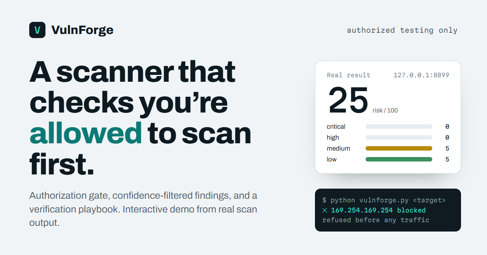

# VulnForge: demo site

An interactive demo that shows how [VulnForge](https://github.com/CyVenom/VulnForge) works, built from real scan output.

VulnForge is an async, plugin-extensible security scanner that checks you are allowed to scan before it sends anything, filters findings by confidence, and tells you how to verify each one by hand. This site walks through one scan, start to finish.

> **Authorized testing only.** VulnForge is for systems you own or have written permission to test. **This site runs no scans and sends nothing to any target.**



## What the demo shows

Five interactive steps, in the order a scan happens:

| Step | What you can do |
|---|---|
| **01 Authorize** | Type a target and watch VulnForge extract the host, resolve it, and check every address against the blocked ranges. Names that point into a reserved range are refused before any traffic. Then answer the `yes / no` authorization prompt. |
| **02 Scan** | Replay one of two real scans: web checks, or nmap service detection plus offline CVE matching. |
| **03 Findings** | Browse every finding from the selected scan. Filter by severity, search, and open one to see the evidence, the fix, and a manual verification playbook. |
| **04 Score** | Move severity sliders and compare the old capped risk score with the current curve. |
| **05 Reports** | See the real HTML report, the trend output, and the other commands (`history`, `diff`, `verify`, `audit`, `schedule`, `serve`). |

It also lists the safety design (authorization gate, inert probes, double-gated credential checks, local-only API) and the tool's honest limits.

## Where the data comes from

Nothing on the page is invented. I ran VulnForge against a throwaway web server on my own machine, once for web checks and once for ports plus CVE matching, and saved the real JSON reports.

| Scan | Findings | Risk | Time |
|---|---|---|---|
| Web scan | 10 (5 medium, 5 low) | 25 | 2.06 s |
| Port + CVE scan | 69 (21 critical, 48 high) | 100 | 10.29 s |

The test server deliberately sends no security headers, sets a cookie with no flags, and announces itself as `Apache/2.4.49`. VulnForge read that banner and matched it to 69 CVEs, including CVE-2021-41773. That shows the CVE path working, and also shows its weakness: a banner can lie, and VulnForge believed it.

### What *is* simulated or ported

Be clear about what you are looking at:

- **The scan replay** is recorded output with the waiting time compressed. The numbers in it (checks, findings, durations, scores) come from the real reports.
- **The authorization check** is the logic of `core/target_guard.py` ported to JavaScript. DNS is a small table of made-up names (`metadata.internal.test` and so on). The real tool asks your operating system's resolver.
- **The score calculator** is the math of `core/risk.py` ported to JavaScript. I verified it against the Python module: 10 highs gives 59, 15 gives 71, 30 gives 90, and 21 critical plus 48 high gives 100.
- **The verification steps** are produced by VulnForge's own `verification_guide`, not written for the page.

## Honest limits

- CVE matching is version-based and reads banners, so false positives exist. The demo says so.
- VulnForge has 118 automated tests. It has **not** been benchmarked against other scanners for accuracy or speed, and this site makes no such claim.
- The blocked-range check resolves DNS once per scan. It protects against mistakes, not against a hostile DNS server.
- The demo covers two scans of one test server. It shows how the tool behaves, not how it performs on real infrastructure.

## Tech

Plain HTML, CSS and JavaScript. No framework, no build step, no dependencies. About 100 KB of code and data, plus a report screenshot and a share image.

- **Fonts:** Archivo and Martian Mono from Google Fonts, the only external requests the page makes.
- **Accessibility:** skip link, real focus states, labelled controls, live regions for the interactive results, and `prefers-reduced-motion` respected.
- **Responsive:** checked at 1440, 1280, 1024, 768 and 390 px. A scripted check found no horizontal overflow and no overlapping elements at any of them.

## Files

```
index.html        the page
styles.css        all styling
app.js            the five interactive sections
data.js           the two real scans (generated, see below)
assets/           screenshot of the real HTML report
tools/make_data.py   regenerates data.js from real reports
tools/sample_server.py   the throwaway server the scans were run against
og.png            share image
```

## Run locally

```
python -m http.server 8000
```

Open http://localhost:8000. Press `Ctrl+C` to stop.

## Reproduce the scans yourself

`tools/sample_server.py` is the throwaway server I scanned. It is deliberately insecure (no security headers, a cookie with no flags, and a `Server` header that falsely claims Apache 2.4.49) and listens on `127.0.0.1` only.

In one terminal:

```
python tools/sample_server.py
```

In another, from your VulnForge folder (with its virtual environment active):

```
python vulnforge.py http://127.0.0.1:8899/ -s web
python vulnforge.py http://127.0.0.1:8899/ --profile quick -p 8899
```

You should get 10 findings with a risk score of 25 for the first, and 69 findings with a score of 100 for the second (the second needs nmap installed). Use `--profile quick` for the second: the default profile also runs nmap's `vuln` scripts and takes minutes. Both commands ask you to confirm authorization; answer `yes`, because it is your own machine. Only ever scan systems you own or have written permission to test.

## Refresh the data

`data.js` is generated. After scanning something you own, regenerate it with the Python that has VulnForge's dependencies (its `.venv`):

```
python tools/make_data.py --vulnforge /path/to/VulnForge \
  --scan "Web scan::What it covers::/path/to/reports/VF-....json" \
  --scan "Port + CVE scan::What it covers::/path/to/reports/VF-....json"
```

The shipped `data.js` is reproducible this way, byte for byte. Check the output for anything you would not want public (target names, file paths) before you commit.

## Deploy

On Vercel, import the repo, leave Framework Preset as **Other**, and leave the build command and output directory empty. The share-image tags in `index.html` point at `https://vulnforge-demo.vercel.app`; change that if your domain differs.

## License

This demo site is MIT licensed. See [LICENSE](LICENSE). VulnForge itself is a separate project; see its repository for its terms.
